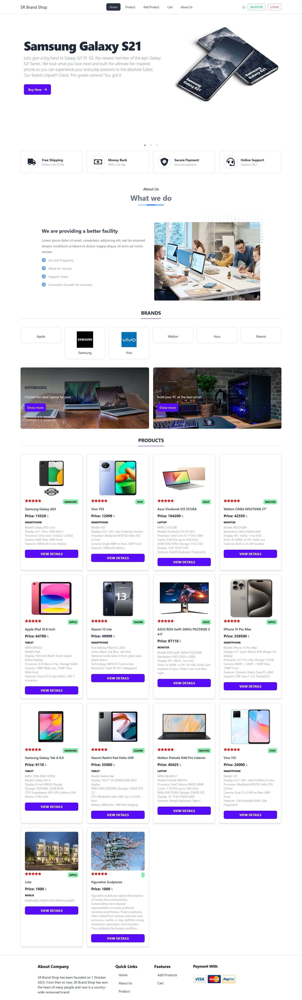

# 🛍️ SR Brand Shop - MERN Stack E-Commerce Platform

[](https://sr-brand-shop.web.app/)
[](https://github.com/wapborhan/brand-shop-mern)
[](https://server-sr-brand-shop.vercel.app)

A modern, responsive full-stack e-commerce web application focused on top **Technology & Electronics** brands (Apple, Samsung, Sony, Google, Intel, etc.). Built with the **MERN** stack (MongoDB, Express, React, Node.js), styled with **Tailwind CSS** and **DaisyUI**, and powered by **Firebase Authentication**.

---

## 🌐 Live Website

- **Live Application**: [https://sr-brand-shop.web.app/](https://sr-brand-shop.web.app/)
- **Backend API Server**: [https://server-sr-brand-shop.vercel.app/](https://server-sr-brand-shop.vercel.app/)

---

## 📸 Preview



---

## ✨ Key Features

- **🔐 Robust User Authentication**:
  - Email & password registration and login with input validation (length, uppercase, special character checks).
  - Social login support via **Google Sign-In**.
  - Persistent login state managed via Firebase Authentication and React Context API.

- **🏷️ Brand-Based Product Navigation**:
  - Interactive brand showcase on the homepage.
  - Dedicated brand product pages featuring advertisement carousel sliders and dynamic brand-filtered products.
  - Informative **"No product found"** fallback message when a brand currently has no products or data is unavailable.

- **📦 Complete Product Management (CRUD)**:
  - **Add Product**: Protected route allowing authenticated users to create products with name, brand, type, price, rating, image URL, and short description.
  - **Update Product**: Ability to edit existing product details with pre-filled forms.
  - **Product Details**: Comprehensive product page displaying rating, pricing, brand details, full specifications, and instant "Add to Cart" action.

- **🛒 Interactive Shopping Cart**:
  - Add items to the cart with duplicate detection and notifications via `react-toastify`.
  - View cart items in a responsive table with item image, brand, category, and price.
  - Remove items from the cart with real-time UI updates and empty cart guidance.

- **🌓 Theme Customization**:
  - Built-in Dark and Light mode toggle for seamless user experience across day and night browsing.

- **📱 Fully Responsive Design**:
  - Tailored UI optimized for mobile devices, tablets, and desktop displays using Tailwind CSS and DaisyUI.

- **🛡️ Protected Routes**:
  - Secure private routes (`/add-product`, `/cart`, `/product/:id`, `/update-product/:id`, `/profile`, `/settings`) redirecting unauthenticated users to the login page and preserving intended destinations.

---

## 🛠️ Tech Stack

### Frontend:
- **React.js (v18)** - Component-based user interface
- **Vite** - High-speed build tool and dev server
- **React Router DOM (v6)** - Client-side dynamic routing
- **Tailwind CSS & DaisyUI** - Utility-first styling & accessible UI components
- **Firebase Auth** - Authentication provider (Email/Password & Google)
- **React Slick & Slick Carousel** - Smooth advertisement sliders
- **React Icons & React Toastify** - Clean icons and notification toasts

### Backend:
- **Node.js & Express.js** - RESTful API backend architecture
- **MongoDB Atlas** - Cloud NoSQL database with native MongoDB driver
- **CORS & Dotenv** - Secure cross-origin requests and environment variable configuration

---

## 📁 Project Structure

```plaintext
brand-shop-mern/
├── client/                     # Frontend React + Vite application
│   ├── public/                 # Static assets and images
│   ├── src/
│   │   ├── assets/             # SVGs and images
│   │   ├── components/         # Shared UI components (Loader, ErrorPage, SignIn, SignUp, ThemeToggle)
│   │   ├── firebase/           # Firebase initialization & configuration
│   │   ├── layout/             # Layout wrappers (Root, Header, Footer, CartList)
│   │   ├── pages/              # Views (HomePage, About, Brands, Product, Cart, Profile)
│   │   ├── provider/           # AuthProvider & Context
│   │   ├── routes/             # Route configurations & PrivateRoutes
│   │   ├── index.css           # Global stylesheet and Tailwind directives
│   │   └── main.jsx            # React root mount
│   ├── package.json
│   └── vite.config.js
├── server/                     # Backend Express application
│   ├── index.js                # Server entry point & API endpoints
│   ├── vercel.json             # Vercel deployment configuration
│   └── package.json
└── README.md                   # Repository documentation
```

---

## 🚀 Getting Started

Follow these instructions to run the project locally on your machine.

### Prerequisites

- [Node.js](https://nodejs.org/) (v16.0 or higher)
- [Git](https://git-scm.com/)
- A free [MongoDB Atlas](https://www.mongodb.com/cloud/atlas) database account
- A [Firebase Project](https://firebase.google.com/) for authentication

---

### 1. Clone the Repository

```bash
git clone https://github.com/wapborhan/brand-shop-mern.git
cd brand-shop-mern
```

---

### 2. Backend Setup

1. Open a terminal and navigate to the `server` directory:
   ```bash
   cd server
   ```

2. Install dependencies:
   ```bash
   npm install
   ```

3. Create a `.env` file in the `server` folder with your MongoDB credentials:
   ```env
   PORT=3300
   DB_NAMEUSER=your_mongodb_username
   DB_PASSCODE=your_mongodb_password
   ```

4. Start the server:
   ```bash
   npm start
   # Server runs on http://localhost:3300
   ```

---

### 3. Frontend Setup

1. Open a new terminal and navigate to the `client` directory:
   ```bash
   cd client
   ```

2. Install dependencies:
   ```bash
   npm install
   ```

3. Configure Firebase in `client/src/firebase/FirebaseInit.js`:
   ```javascript
   import { initializeApp } from "firebase/app";

   const firebaseConfig = {
     apiKey: "YOUR_API_KEY",
     authDomain: "YOUR_AUTH_DOMAIN",
     projectId: "YOUR_PROJECT_ID",
     storageBucket: "YOUR_STORAGE_BUCKET",
     messagingSenderId: "YOUR_MESSAGING_SENDER_ID",
     appId: "YOUR_APP_ID"
   };

   export const app = initializeApp(firebaseConfig);
   ```

4. Launch development server:
   ```bash
   npm run dev
   ```

5. Open your browser and navigate to `http://localhost:5173`.

---

## 📡 API Endpoints Reference

| Method | Endpoint | Description |
|---|---|---|
| `GET` | `/products` | Retrieve all products |
| `POST` | `/products` | Create a new product |
| `GET` | `/product/:id` | Retrieve single product details |
| `PUT` | `/product/:id` | Update product information |
| `GET` | `/brands` | Retrieve all brands |
| `GET` | `/brands/:name` | Retrieve products by brand name |
| `GET` | `/cart` | Retrieve all cart items |
| `POST` | `/cart` | Add a product to cart |
| `DELETE` | `/cart/:id` | Remove a product from cart |

---

## 📄 License

This project is developed for educational and portfolio purposes.
