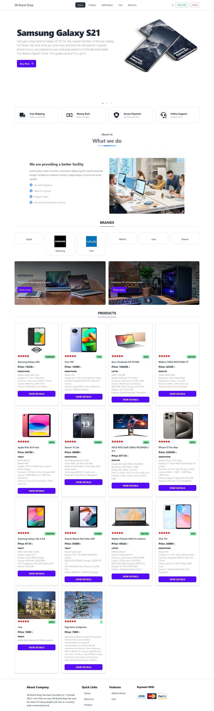

# 🛍️ SR Brand Shop - Frontend Client

[](https://sr-brand-shop.web.app/)

The client-side single-page application for **SR Brand Shop**, built with React, Vite, Tailwind CSS, and Firebase Authentication.

---

## 🌐 Live Website

- **Live URL**: [https://sr-brand-shop.web.app/](https://sr-brand-shop.web.app/)
- **Backend API**: [https://server-sr-brand-shop.vercel.app/](https://server-sr-brand-shop.vercel.app/)

---

## 📸 Preview



---

## 🌟 Features

- **User Authentication**: Secure email/password login and registration with validation, plus Google one-click sign-in.
- **Brand Showcase & Filtering**: Browse by renowned tech brands with dynamic brand sliders and product listings.
- **Graceful Empty State Handling**: Displays "No product found" when brand products are empty or unavailable.
- **Product Management**: Authenticated users can add new products and edit existing ones.
- **Product Details & Cart**: Detailed product view with rating, specifications, and cart management (add, view, remove).
- **Theme Switcher**: Instant toggle between Dark and Light display modes.
- **Protected Routes**: Sensitive pages (`/cart`, `/add-product`, `/update-product/:id`, `/product/:id`) require authentication.

---

## 💻 Tech Stack

- **React 18** & **Vite**
- **React Router DOM 6**
- **Tailwind CSS** & **DaisyUI**
- **Firebase Authentication**
- **React Slick** & **Slick Carousel**
- **React Toastify** & **React Icons**

---

## 🚀 Local Development

1. Install dependencies:
   ```bash
   npm install
   ```

2. Start development server:
   ```bash
   npm run dev
   ```

3. Build for production:
   ```bash
   npm run build
   ```
